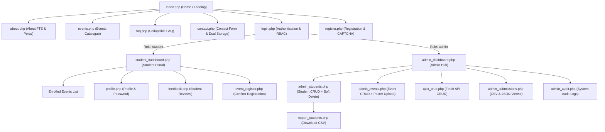
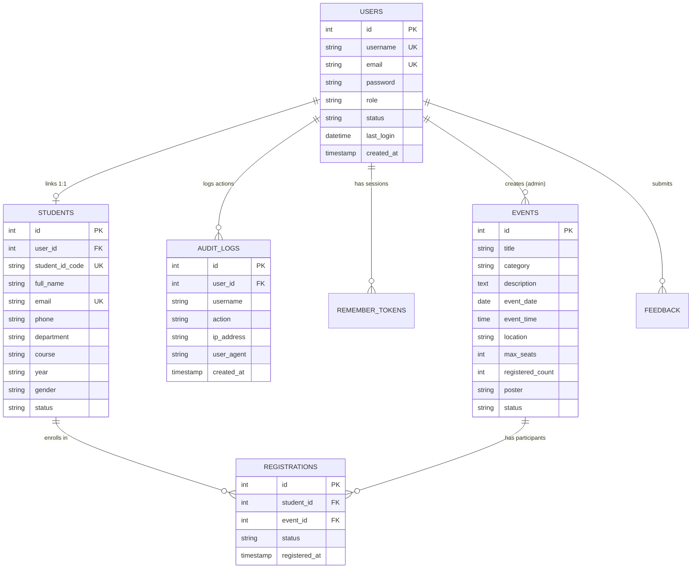

# StudentHub Portal - Sitemap, Architecture & Wireframes
**Subject:** Web Development Frameworks (ITUE203) - Practical 1  
**Institute:** CHARUSAT - Faculty of Technology and Engineering (FTE)

---

## 1. Portal Scope & User Roles

The **StudentHub Portal** serves three primary user personas:

| Role | Access Level | Description & Core Responsibilities |
| :--- | :--- | :--- |
| **Guest / Visitor** | Public | Explores university announcements, browses public events, reads FAQs, submits contact messages, registers/logs in. |
| **Student** | Authenticated | Views personalized dashboard, manages profile, browses & registers for hackathons and workshops, cancels registrations, submits 5-star portal reviews. |
| **Administrator** | Elevated / Moderation | Full system monitoring, manages student directory (CRUD + Soft Delete + CSV export), manages events (CRUD + validated poster uploads), moderates users (Active/Inactive status toggle), inspects system audit trail. |

---

## 2. Complete Visual Sitemap



---

## 3. Relational Entity-Relationship (ER) Model (3NF)



---

## 4. UI Wireframe Layouts

### A. Desktop Portal Header & Hero
```
+-----------------------------------------------------------------------------------+
| [Logo] StudentHub       Home   About   Events   FAQ   Contact   [Admin/Student]   [Theme]|
+-----------------------------------------------------------------------------------+
|  [========================== HERO SLIDER CAROUSEL =============================]  |
|  "One Unified Campus Portal - CHARUSAT Faculty of Technology & Engineering"       |
|  [< Prev]                                                                [Next >] |
+-----------------------------------------------------------------------------------+
|  [ 20+ Active Students ]   [ 15 Open Events ]   [ 5 Confirmed Seats ]   [ ITUE203 ] |
+-----------------------------------------------------------------------------------+
```

### B. Mobile Responsive Navigation
```
+---------------------------------------+
| [Logo] StudentHub          [Theme] [=]|
+---------------------------------------+
| [=] Collapsible Hamburger Menu:       |
|   - Home                              |
|   - About FTE                         |
|   - Campus Events                     |
|   - FAQ & Support                     |
|   - Sign In / Register                |
+---------------------------------------+
```
